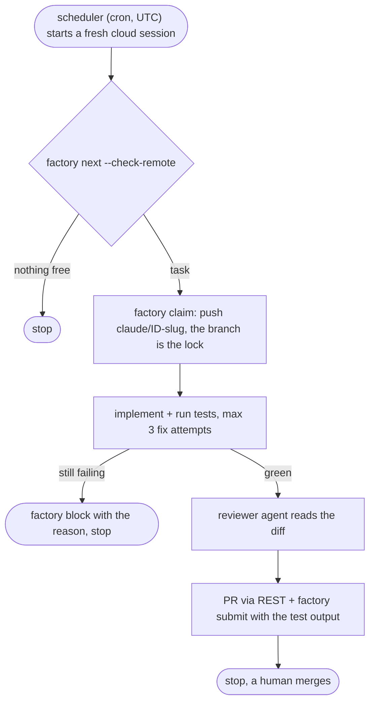

<h1 align="center">Nightshift</h1>

<p align="center">
  <b>Scheduled Claude Code agents that take one task from your backlog and open a pull request with real test evidence.<br>
  They never merge, deploy or force-push on their own.</b>
</p>

<p align="center">
  <a href="https://github.com/yuroka-studio/nightshift-agents/actions/workflows/ci.yml"></a>
  
  
  = 22">
</p>

<p align="center">
  <a href="#quickstart">Quickstart</a> ·
  <a href="#how-a-night-goes">How a night goes</a> ·
  <a href="#safety-model">Safety model</a> ·
  <a href="docs/field-report-001.md">Field report</a> ·
  <a href="#gotchas-we-hit-so-you-dont-have-to">Gotchas</a>
</p>

> Unofficial community project. Not affiliated with or endorsed by Anthropic.

Nightshift is a small, file-based "software factory" for running [Claude Code](https://docs.claude.com/en/docs/claude-code/overview) unattended against a backlog. It is about 1,300 lines of dependency-free Node, one skill, three agent definitions and a Bash guard hook. It was built by running real unattended agents and writing down what broke.

When an agent works while you sleep, writing the code is the easy part. The hard part is:

- picking **which** task to do, and making sure two runs never pick the same one;
- proving the work was **tested** before anything is called done;
- making sure "unattended" never turns into "merged to main" or "deployed";
- leaving a trail that the next session, or you over coffee, can pick up from.

## What you wake up to

The daily report from a demo backlog (`node bin/factory.mjs report`, real output, trimmed):

```md
## Shipped
- T-001 Add a /health endpoint (self, in_review)
  - PR: https://github.com/acme/shop/pull/12
  - Evidence [2026-10-31T12:29:47Z]: npm test: 64 passed, 0 failed (6 new in test/health.test.mjs)

## In flight
- T-002 Rate-limit the login route (self) - branch claude/t-002-rate-limit-the-login-route, claimed by nightly-0500

## Blocked
- T-004 Fix flaky checkout test (self) - failure reproduces only with the CI database image; needs a human

## Next ready
- T-003 Paginate GET /orders (self, p3)
```

A task counts as shipped only with a PR link and passing evidence from that day. A run that gets stuck says why and stops; it does not guess.

## Quickstart

```sh
# 1. Create a repo from this template (or clone it), then inside it:
npm test                                   # zero dependencies, no install step
git config core.hooksPath scripts/hooks    # turns on the pre-commit secret scan
node bin/factory.mjs init --owner <you> --repo <you>/<repo>
node bin/factory.mjs doctor

# 2. Add work. Every task needs at least one checkable acceptance criterion.
node bin/factory.mjs add "Add a /health endpoint" --project self \
  --accept "GET /health returns 200 with {status:'ok'}" --accept "npm test passes"
```

3. Start Claude Code **inside the repo** (`cd <repo> && claude`) and say *"deliver the next task"*.
4. Make it unattended. In Claude Code, run `/schedule` with the prompt in [`examples/routine-prompt.md`](examples/routine-prompt.md), or post [`examples/routine.json`](examples/routine.json) through the routines API. Cloud runs need GitHub connected to Claude Code on the web: the Claude GitHub App, restricted to this repo, is the narrowest option.
5. In the morning: `node bin/factory.mjs report`, review the PR, merge it yourself.

Nightshift lives **inside the repository it works on**: one repo per scheduled task. Multi-repo support is on the roadmap.

## How a night goes



1. `next --check-remote` picks the highest-priority ready task and skips any task whose `claude/<id>-*` branch already exists on origin. It fails closed if origin can't be reached.
2. `claim` takes a lease and pushes the branch. The branch on origin is the lock, so two runs can't take the same task.
3. The agent implements, runs the tests, and gets at most three fix attempts. After that it records a blocker and stops.
4. An independent `reviewer` agent reads the diff before the PR is opened.
5. `submit` refuses to move the task to review without the real test output.

## What you get

| Piece | What it does |
|---|---|
| `factory` CLI | Backlog with acceptance criteria, dependencies, priorities, a WIP limit and claim leases. Plain JSON in git, no database. |
| Remote-branch lock | `next --check-remote` skips tasks that already have a branch on origin, and fails closed when origin is unreachable. |
| Evidence gate | `submit` refuses to move a task to review without the real test or build output. |
| `report` | Daily report. Shipped means a PR URL plus passing evidence dated that day. Secrets are redacted. |
| `doctor` | Self-check of the tools and the factory data. |
| `deliver-task` skill | The one-task loop: claim, branch, implement, verify, review, PR, record. |
| Agents | `implementer` and `reviewer` (Sonnet), `architect` (Opus, for rare hard calls). |
| Guard hook | PreToolUse hook on Bash that blocks force-push, pushes to main, branch deletion, merges, publishing, production deploys and history-destroying commands. |
| Secret scan | Pre-commit hook over staged changes. It reports the file and the pattern, never the value. |
| CI | GitHub Actions running the test suite. |

## Safety model

**Covered by tests:**

- tasks without acceptance criteria are rejected;
- a claimed task can't be taken by another run until its lease expires;
- nothing reaches review without evidence;
- the report never lists unverified work as shipped;
- the guard blocks the forms of force-push, main push, branch deletion, merge, publish, deploy, reset/clean and config injection listed in [`test/`](test).

**Merging** is off by default. It opens only in a session the owner started inside the repo with `FACTORY_ALLOW_MERGE=1 FACTORY_MERGE_OWNER=<owner>`, and then only as `--squash` with the repo named explicitly. Both values come from the launching environment; nothing in the repo can set them. Claude Code's own permission layer may still refuse, and the full flow is unverified.

**Not guaranteed:** the guard is **accident prevention, not a security boundary**. It does not inspect scripts that run git internally, aliases from an existing global git config, `curl`, or tools other than Bash, and a hook that crashes lets the command through. It shrinks what a confused agent can break; it will not stop a determined one. Use GitHub branch protection wherever your plan allows it.

## Evidence, not vibes

[Field report #001](docs/field-report-001.md): the scheduler fired a one-shot task. It found 4 branches already in flight, took the only free task, wrote the code and 6 tests, recorded the evidence and finished in 133 seconds over 29 turns. The suite passed 59/59, and was re-run independently.

One run is not a track record. More reports will follow, failures included.

## Gotchas we hit, so you don't have to

1. **Hooks load only when Claude starts inside the repo.** Start Claude from `~` and the guard is simply not there, and nothing tells you.
2. **Permission `deny` rules beat hooks.** A `deny` on `gh pr merge` turns any hook-based merge gate into dead code.
3. **The platform may open the PR for you.** Pushing a `claude/*` branch from a cloud session opened a PR with a title made from the branch name and an empty body, so our own create call got HTTP 422. The skill now edits the title and body instead.
4. **`gh pr create/view/list` fail inside cloud runs** (GraphQL 403, per the docs). Use `gh api` REST calls.
5. **Test your guard against the exact commands your skill prescribes.** Our first unattended run was blocked 7 times by our own guard: `2>&1` read as a refspec, quoted values with spaces split into words, no way to edit a PR.
6. **Free private repos have no branch protection** (the API returns 403). Your guard and your review are all that stand between an agent and `main`.
7. **Shared state files conflict across parallel PRs.** Task PRs touch only their own backlog entry; checkpoints go in separate PRs.

## Prior art

If you only want a command guard for interactive sessions, use a focused one, for example [git-guardrails-claude-code](https://github.com/mattpocock/skills/tree/main/skills/misc/git-guardrails-claude-code). Nightshift's guard is written for *unattended* runs:

- a merge gate tied to the owner's launch environment;
- a `gh api` write policy that only lets an agent create, comment on and retitle PRs;
- parsing that understands quotes, heredocs and command substitution.

It also ships with the backlog, lock and evidence loop around it.

## Layout

```
bin/factory.mjs                 CLI entry point (node bin/factory.mjs help)
lib/                            tasks, store, guard, secret scan; one file per command in lib/commands/
factory/                        registry.json (owner, policy, projects), backlog.json, state.json
.claude/                        settings (permissions + hook), agents, the deliver-task skill
scripts/hooks/                  guard-bash.mjs (Claude hook), pre-commit + secret-scan.mjs (git hook)
docs/                           architecture, runbook, field reports
examples/                       scheduled-task body and prompt
```

More detail: [architecture](docs/architecture.md) · [runbook](docs/runbook.md).

## Roadmap

- `factory reconcile`: mark tasks done when their PR merges.
- `factory reap`: release expired claims.
- Multi-repo: one scheduled task per repo with per-repo backlogs.
- A one-line installer for existing repos.

## More from Yuroka Studio

Small, offline tools with no paid services, all MIT:

- [shigley-calc](https://github.com/yuroka-studio/shigley-calc): tested machine-element calculators (endurance limit, fatigue, shafts, bolt groups) with an offline web page.
- [waveform-peaks](https://github.com/yuroka-studio/waveform-peaks): turn songs into compact waveform data for web players.
- [type-cover](https://github.com/yuroka-studio/type-cover): deterministic, code-generated typographic cover art.
- [play-dev-site](https://github.com/yuroka-studio/play-dev-site): a static developer website with the privacy and account-deletion pages Google Play asks for.

## Contributing and security

See [CONTRIBUTING.md](CONTRIBUTING.md) and [SECURITY.md](SECURITY.md).

## License

MIT © 2026 Yuroka Studio. "Claude" and "Claude Code" are trademarks of Anthropic.
